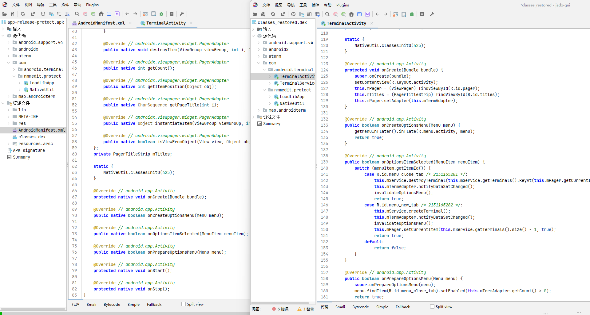

# unmmp - nmmp 虚拟机加固还原工具

**简体中文** | [English](README.EN.md)

基于 Unicorn 模拟执行，将 [nmmp](https://github.com/maoabc/nmmp) dex-vm 加固的 native 方法还原为 dex 字节码。

支持 ARM32、ARM64、x86、x86_64 任意架构的加固 APK。

## 效果


## 安装

```powershell
python -m pip install -r requirements.txt
```

依赖：Python3、Unicorn 2.1.4 或更高的 2.x 版本。

重建 dex 需要 Java 环境。项目自带可执行的 baksmali / smali jar。

来源：[smali v2.5.2](https://github.com/baksmali/smali/releases?page=2#release-v2.5.2)。

| 文件 | SHA256 |
|---|---|
| tools/baksmali-2.5.2.jar | d3116248cce4f82ec5a31eb7f95ee75daff42ddf6eed0ab573973dc53fbad2e5 |
| tools/smali-2.5.2.jar | 9544299578b16f771d8aa8eaefe0d3718ca03478c16f3c356f2fcf1366bfb116 |

## 用法

```powershell
python unmmp.py 应用.apk -o out
python unmmp.py 应用.apk -o out --prefer-abi armeabi-v7a
python unmmp.py 应用.apk -o out --skip-dex
```

- --skip-dex：输出映射、方法体和恢复统计，跳过 dex 组装。
- --prefer-abi：选择一对指定 ABI 的库；默认 arm64-v8a、armeabi-v7a、x86_64、x86。

支持 APK，以及包含 dex、libnmmp.so、libnmmvm.so 的提取目录。

复用输出目录时会清理旧恢复 dex、映射、方法体、摘要、错误报告及生成目录。work/、smali*/、patched_smali*/ 为工具保留目录。输入必须位于这些生成目录之外，且不能与输出目录相同。

恢复失败时会删除本次生成的全部恢复 dex 和成功摘要，保留诊断与中间文件。显式指定 --prefer-abi 时，只使用指定 ABI；找不到库对即报错。

## 输出

- classes_restored.dex、classes2_restored.dex 等：恢复的 dex。容量溢出时，输出数量可能增加。
- opcode_mapping.json：当前 APK 的语义映射。
- opcode_aliases.json：编译器合并后需要类型上下文区分的变体。
- native_methods.json、lifted_bodies.json：方法绑定及 smali 方法体。
- recovery_summary.json：提取、解码、patch、输出文件及验证统计。
- work/：组装过程中使用的临时 dex 及拆分后的 smali。
- smali/、patched_smali/，多 dex 使用相应后缀。

映射中的部分名称是语义代表名；return、invoke、move 的最终形式结合方法声明和寄存器类型确定。

## 原理

[nmmp 加固与 unmmp 还原原理](intro.html)

nmmp 将方法字节码交给 native 虚拟机解释执行，并重写 opcode 和符号引用索引。unmmp 使用 Unicorn 模拟目标库，通过实际执行行为恢复这些信息：

1. 拦截 JNI 方法注册和虚拟机入口，取得方法绑定、字节码、异常表及寄存器布局。
2. 在目标解释器中执行受控指令，将寄存器变化、跳转和 JNI 调用与 Dalvik 语义对比，识别 opcode。
3. 调用目标库的 resolver 解析字段、方法、类型和字符串引用，结合 dex 元数据生成 smali，替换 native 方法并重建 dex。

恢复所需信息来自 APK 自身，不依赖固定 opcode 映射。组装时处理字符串和索引容量限制，并校验输出 dex 与恢复方法体；遇到无法识别的调用或语义会明确报错。

## 官方 DEMO 测试结果

| APK | 默认 ABI | 提取 / 解码 / patch | 输出 dex |
|---|---|---|---|
| app-release-protect.apk | ARM64 | 7987 / 7987 / 7987 | 1 |

ARM64、x86_64 均完整恢复 7987 个方法，输出 dex 通过校验和、方法签名及 code_item 检查。

## 范围

- 面向官方已有的 dex2c VM 实现；不支持任意修改 VM 规范的版本。
- 不恢复 C++ 源码模式；与其他壳叠加时需先取得可分析的库和 dex。
- 不新增源码中缺失的 invoke-custom / invoke-polymorphic VM 实现。
- 当前重建支持原 dex 035、037、038、039。
- 有限语义探测与结构校验不能代替完整的 Android 运行验证。

## 许可证

本项目采用 [MIT 许可证](LICENSE)。
